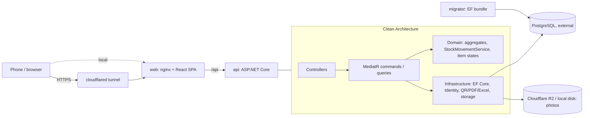

# StockTracker

Stock tracking for a workshop or office: print QR labels, scan them with a phone, and every
receipt, transfer, loan and count lands in an append-only movement ledger.

<!-- Screenshots and the phone scanning GIF go here (docs/images/). -->

## Features

- **Two kinds of products:** serialized devices tracked one by one (serial number, status,
  location, owner) and quantity stock tracked per shelf ([ADR 001](docs/adr/001-mixed-product-model.md)).
- **Scanning:** phone or webcam camera (QR, EAN/UPC) or typed codes; a label's QR opens the
  item page even from the phone's own camera app ([ADR 006](docs/adr/006-qr-content-url.md)).
- **Location tree:** building › room › cabinet › shelf › box, any depth, with contents per subtree.
- **Movements:** stock in, out, transfer, multi-line receipts; full history per product, item,
  location and user.
- **Assignments:** lend devices to people (with or without a login), due dates, overdue
  tracking, faulty returns go to repair.
- **Counts:** scan a location, review differences, approve; differences become adjustments.
- **Labels:** PDF sheets (A4 3×8, 2×4, 5×13) and thermal rolls, for products, items, a whole
  receipt or a location subtree.
- **Alerts:** low stock, due tomorrow, overdue; a daily check plus checks after each movement.
- **Dashboard and Excel reports:** stock status, movement log, assignment list.
- **Audit log, product photos, roles** (Admin, Warehouse manager, Staff) with policy-based access.

## Architecture



- **Backend:** .NET 10, ASP.NET Core controllers + MediatR (CQRS), FluentValidation, EF Core +
  Npgsql, ASP.NET Core Identity + JWT, QRCoder, QuestPDF, ClosedXML, SkiaSharp, Serilog.
- **Frontend:** React + TypeScript (Vite), Mantine + Mantine Charts, TanStack Query, React
  Router, React Hook Form + Zod, `@zxing/browser`; API types generated from OpenAPI.
- **Writes** go through aggregate repositories and a unit of work; **reads** are `AsNoTracking`
  projections straight to DTOs ([ADR 003](docs/adr/003-write-read-separation.md)).
- **Tests:** xUnit + FluentAssertions with real PostgreSQL in Testcontainers (500+ backend
  tests, including a reflection test that pins the access policy of all 71 endpoints), Vitest +
  React Testing Library.

### The movement ledger

Stock is never edited. Every change is a `StockMovement` row, and the database rejects
`UPDATE` and `DELETE` on that table with a trigger. Shelf balances and an item's location are
results of movements, written in the same transaction and guarded by optimistic concurrency
(`xmin`). A count does not overwrite quantities: it adds adjustment movements. So every number
on screen can be traced back to who did what and when, and the balances can be rebuilt from the
ledger at any time ([ADR 002](docs/adr/002-movement-ledger.md)).

## Run it locally

Needs Docker only. This uses a bundled PostgreSQL and the demo data:

```bash
git clone <this repository> stocktracker && cd stocktracker
docker compose -f docker-compose.yml -f docker-compose.local.yml up -d --build
docker compose -f docker-compose.yml -f docker-compose.local.yml run --rm api seed-demo
```

Open http://localhost:8080.

### Demo accounts

All demo accounts use the password `Demo12345`.

| E-mail | Role | Sees |
|---|---|---|
| `admin@demo` | Admin | everything, users, audit log |
| `depo@demo` | Warehouse manager | stock operations, counts, labels, dashboard, reports |
| `personel@demo` | Staff | catalog, scanning, own assignments, counting |

The "Demo Atölye" data: a building with 3 rooms, 40 products, 150 devices, six months of
movements, 10 open assignments (2 overdue), an approved count and 2 products below their
minimum. On a server with `DEMO_MODE=true`, `run --rm api reset-demo` restores it.

## Documentation

- [docs/PLAN.md](docs/PLAN.md): plan and every decision taken while building (Turkish)
- [docs/adr/](docs/adr/): architecture decision records 001–006
- [docs/api.md](docs/api.md): endpoints, access, examples
- [docs/deploy.md](docs/deploy.md): production compose, images, settings
- [docs/performance.md](docs/performance.md): load data and measurements

## Development

### Prerequisites

- .NET SDK 10
- Node.js 24+
- Docker (integration tests use Testcontainers; also needed for Compose)
- A PostgreSQL server (or the `db` service of `docker-compose.local.yml`)

### Backend

```bash
cd backend
dotnet tool restore
dotnet build
dotnet test
export ConnectionStrings__Default="Host=localhost;Database=stocktracker;Username=...;Password=..."
export Jwt__Issuer=stocktracker Jwt__Audience=stocktracker Jwt__SigningKey="$(openssl rand -base64 48)"
export SEED_ADMIN_EMAIL=admin@example.com SEED_ADMIN_PASSWORD=Admin12345
dotnet ef database update -p src/StockTracker.Infrastructure -s src/StockTracker.Api --connection "$ConnectionStrings__Default"
dotnet run --project src/StockTracker.Api
```

The API listens on http://localhost:5180. Swagger UI: http://localhost:5180/swagger (Development only).

`GET /health` reports `Healthy` when the database is reachable.

Sign in from Swagger with `POST /api/auth/login`, then paste the `accessToken` into **Authorize**.
The refresh token is set as an `HttpOnly` cookie scoped to `/api/auth`.

Data commands run instead of the web server (`DEMO_MODE=true` required):
`dotnet run --project src/StockTracker.Api -- seed-demo | reset-demo | seed-load`.

### Frontend

```bash
cd frontend
npm install
npm run dev        # http://localhost:5273, proxies /api to http://localhost:5180
npm run lint
npm run test
npm run build
npm run gen:api    # regenerates src/api/schema.d.ts; the backend must be running in Development
```

Set `API_PROXY_TARGET` to proxy `/api` somewhere other than `http://localhost:5180`.

### Docker Compose with an external database

```bash
cp .env.example .env            # then set ConnectionStrings__Default
docker compose run --rm migrator  # apply migrations (never automatic)
docker compose up --build         # web on http://localhost:8080
```

The `api` container is not published to the host; `web` (nginx) serves the app and proxies `/api` to it.

### Testing on a phone

The camera only works over HTTPS. Start the Cloudflare quick tunnel:

```bash
docker compose --profile tunnel up --build
```

Open the `https://….trycloudflare.com` URL printed in the `cloudflared` logs on the phone, sign in and use **Tara** in the top bar.
Set `PUBLIC_BASE_URL` to that address so printed QR labels (`{PUBLIC_BASE_URL}/s/{code}`) open the app from the phone's own camera.
The tunnel URL is public while it runs.

## Configuration

Secrets are provided only through environment variables. Copy `.env.example` to `.env` and fill in the values.
