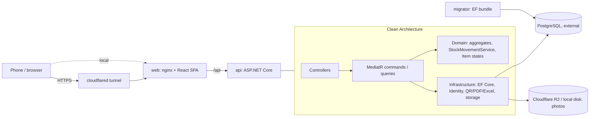

<div align="center">

# 📦 StockTracker

**QR and barcode based stock tracking for workshops and offices.**<br>
Print labels, scan them with a phone, and every receipt, transfer, loan and count lands in an
append-only movement ledger.

[](https://github.com/devberatzengin/StockTracker/actions/workflows/backend.yml)
[](https://github.com/devberatzengin/StockTracker/actions/workflows/frontend.yml)
[](https://github.com/devberatzengin/StockTracker/actions/workflows/docker.yml)
[](https://github.com/devberatzengin/StockTracker/actions/workflows/gitleaks.yml)
[](https://github.com/devberatzengin/StockTracker/tags)


[Features](#-features) ·
[Quick start](#-quick-start) ·
[Architecture](#-architecture) ·
[Tech stack](#-tech-stack) ·
[Documentation](#-documentation) ·
[Development](#-development)

</div>

<!-- Screenshots and the phone scanning GIF go here (docs/images/). -->

---

## ✨ Features

| | |
|---|---|
| 🏷️ **Two kinds of products** | Serialized devices tracked one by one (serial number, status, location, owner) and quantity stock tracked per shelf. [ADR 001](docs/adr/001-mixed-product-model.md) |
| 📱 **Scanning** | Phone or webcam camera (QR, EAN/UPC) or typed codes. A label's QR opens the item page even from the phone's own camera app. [ADR 006](docs/adr/006-qr-content-url.md) |
| 🗂️ **Location tree** | Building › room › cabinet › shelf › box, any depth, with contents per subtree. [ADR 004](docs/adr/004-materialized-path.md) |
| 🔁 **Movements** | Stock in, out, transfer, multi-line receipts; wrong entries are reversed with an opposite movement, never edited. Full history per product, item, location and user. |
| 🤝 **Assignments** | Lend devices to people (with or without a login), due dates, overdue tracking; faulty returns go to repair. |
| 🧮 **Counts** | Scan a location, review the differences, approve; differences become adjustment movements. |
| 🖨️ **Labels** | PDF sheets (A4 3×8, 2×4, 5×13) and thermal rolls, for products, items, a whole receipt or a location subtree. |
| 🔔 **Alerts** | Low stock, due tomorrow, overdue: a daily check plus checks after each movement. |
| 📊 **Dashboard & reports** | Cards and charts, plus Excel exports: stock status, movement log, assignment list. |
| 🛡️ **Audit & roles** | Audit log of every change, product photos, roles (Admin, Warehouse manager, Staff) with policy-based access. |

## 🚀 Quick start

Needs **Docker** only. This starts a bundled PostgreSQL and loads the demo data:

```bash
git clone https://github.com/devberatzengin/StockTracker.git && cd StockTracker
docker compose -f docker-compose.yml -f docker-compose.local.yml up -d --build
docker compose -f docker-compose.yml -f docker-compose.local.yml run --rm api seed-demo
```

Open **http://localhost:8080**.

### Demo accounts

All demo accounts use the password `Demo12345`.

| E-mail | Role | Can |
|---|---|---|
| `admin@demo` | Admin | everything, users, audit log |
| `depo@demo` | Warehouse manager | stock operations, counts, labels, dashboard, reports |
| `personel@demo` | Staff | catalog, scanning, own assignments, counting |

The **"Demo Atölye"** data: a building with 3 rooms, 40 products, 150 devices, six months of
movements, 10 open assignments (2 overdue), an approved count and 2 products below their minimum.

## 🏛️ Architecture



| Layer | Responsibility |
|---|---|
| `StockTracker.Domain` | Aggregates, domain rules, Item State pattern, `StockMovementService`; no dependencies |
| `StockTracker.Application` | MediatR commands and queries, validation, DTOs, interfaces |
| `StockTracker.Infrastructure` | EF Core, repositories, Identity + JWT, QR/PDF/Excel, file storage, background jobs |
| `StockTracker.Api` | Thin controllers, policies, ProblemDetails error handling |

- **Writes** go through aggregate repositories and a unit of work; **reads** are `AsNoTracking`
  projections straight to DTOs. [ADR 003](docs/adr/003-write-read-separation.md)
- **Auth:** access token in memory, refresh token in an `HttpOnly` + `Secure` + `SameSite=Strict`
  cookie with rotation and reuse detection. [ADR 005](docs/adr/005-token-storage.md)

### 📒 The movement ledger

Stock is never edited. Every change is a `StockMovement` row, and the database rejects `UPDATE`
and `DELETE` on that table with a trigger. Shelf balances and an item's location are results of
movements, written in the same transaction and guarded by optimistic concurrency (`xmin`). A
count does not overwrite quantities: it adds adjustment movements. So every number on screen can
be traced back to who did what and when, and the balances can be rebuilt from the ledger at any
time. [ADR 002](docs/adr/002-movement-ledger.md)

## 🧰 Tech stack

| Area | Technologies |
|---|---|
| **Backend** | .NET 10, ASP.NET Core (controllers), MediatR 12 (CQRS), FluentValidation, Serilog, Swagger |
| **Data** | PostgreSQL, EF Core 10 + Npgsql, EFCore.NamingConventions (snake_case) |
| **Auth** | ASP.NET Core Identity, JWT Bearer, refresh token cookie, login rate limiting |
| **Documents** | QRCoder (QR), QuestPDF (label PDFs), ClosedXML (Excel), SkiaSharp (photos) |
| **Storage** | Local disk with signed URLs, or Cloudflare R2 (AWS S3 SDK) |
| **Frontend** | React 19, TypeScript, Vite, Mantine + Mantine Charts, TanStack Query, React Router, React Hook Form + Zod, `@zxing/browser` |
| **Testing** | xUnit, FluentAssertions, Testcontainers (real PostgreSQL), Vitest, React Testing Library |
| **Ops** | Docker Compose, nginx (security headers), Cloudflare Tunnel, GitHub Actions, GHCR images, gitleaks, nightly `pg_dump` backups with a restore test |

## ✅ Quality

- **544 backend tests** (domain, application, API integration against real PostgreSQL) and
  **116 frontend tests**.
- A reflection test pins the access policy of all **72 endpoints**; no endpoint can ship without one.
- Load data of 1,000 products and 50,000 movements: every list endpoint and the dashboard stay
  well under the 300 ms target. [docs/performance.md](docs/performance.md)
- Stock commands are idempotent (`Idempotency-Key`): a double click or a network retry never books twice.
- A daily job reconciles every balance and item with the ledger and alerts the admins on any difference.
- Rate limits per user and per IP, stricter for login, token refresh and heavy endpoints.
- Nightly database backups with a scripted restore test.
- CI on every push: build + tests, Docker image builds, secret scan of the full history.

## 📚 Documentation

| Document | Contents |
|---|---|
| [docs/PLAN.md](docs/PLAN.md) | Plan and every decision taken while building (Turkish) |
| [docs/adr/](docs/adr/) | Architecture decision records 001–006 |
| [docs/api.md](docs/api.md) | Endpoints, access levels, request/response examples |
| [docs/deploy.md](docs/deploy.md) | Production compose, images, settings, backups |
| [docs/performance.md](docs/performance.md) | Load data, measurements, query plans |

## 🛠️ Development

<details>
<summary><b>Prerequisites</b></summary>

- .NET SDK 10
- Node.js 24+
- Docker (integration tests use Testcontainers; also needed for Compose)
- A PostgreSQL server (or the `db` service of `docker-compose.local.yml`)

</details>

<details>
<summary><b>Backend</b></summary>

```bash
cd backend
dotnet tool restore
dotnet build
dotnet test
export ConnectionStrings__Default="Host=localhost;Database=stocktracker;Username=...;Password=..."
export Jwt__Issuer=stocktracker Jwt__Audience=stocktracker Jwt__SigningKey="$(openssl rand -base64 48)"
export SEED_ADMIN_EMAIL=admin@example.com SEED_ADMIN_PASSWORD=Admin12345
dotnet ef database update -p src/StockTracker.Infrastructure -s src/StockTracker.Api --connection "$ConnectionStrings__Default"
dotnet run --project src/StockTracker.Api
```

The API listens on http://localhost:5180. Swagger UI: http://localhost:5180/swagger (Development only).
`GET /health` reports `Healthy` when the database is reachable.

Sign in from Swagger with `POST /api/auth/login`, then paste the `accessToken` into **Authorize**.
The refresh token is set as an `HttpOnly` cookie scoped to `/api/auth`.

Data commands run instead of the web server (`DEMO_MODE=true` required):
`dotnet run --project src/StockTracker.Api -- seed-demo | reset-demo | seed-load`.

</details>

<details>
<summary><b>Frontend</b></summary>

```bash
cd frontend
npm install
npm run dev        # http://localhost:5273, proxies /api to http://localhost:5180
npm run lint
npm run test
npm run build
npm run gen:api    # regenerates src/api/schema.d.ts; the backend must be running in Development
```

Set `API_PROXY_TARGET` to proxy `/api` somewhere other than `http://localhost:5180`.

</details>

<details>
<summary><b>Docker Compose with an external database</b></summary>

```bash
cp .env.example .env              # then set ConnectionStrings__Default and the keys
docker compose run --rm --build migrator   # apply migrations (never automatic)
docker compose up -d --build      # web on http://localhost:8080
```

The `api` container is not published to the host; `web` (nginx) serves the app and proxies `/api` to it.
Secrets are provided only through environment variables; `.env` is never committed.

</details>

<details>
<summary><b>Testing on a phone</b></summary>

The camera only works over HTTPS. Start the Cloudflare quick tunnel:

```bash
docker compose --profile tunnel up --build
```

Open the `https://….trycloudflare.com` URL printed in the `cloudflared` logs on the phone, sign in
and use **Tara** in the top bar. Set `PUBLIC_BASE_URL` to that address so printed QR labels
(`{PUBLIC_BASE_URL}/s/{code}`) open the app from the phone's own camera. The tunnel URL is public
while it runs and changes on every start.

</details>

## 📁 Repository layout

```
backend/    ASP.NET Core solution: Domain, Application, Infrastructure, Api + tests
frontend/   React app (features/*), nginx config
docs/       Plan, ADRs, API, deploy and performance notes
docker/     Backup image (nightly pg_dump)
scripts/    Smoke test, restore test, performance measurement, API doc generator
```

---

<div align="center">

Built by [Berat Zengin](https://github.com/devberatzengin) as a portfolio project.

</div>
